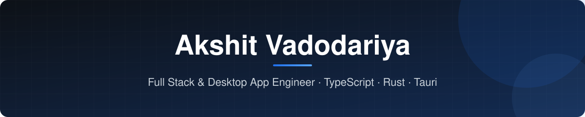

  

  
  
  
  

 

## About

I'm a Full Stack Engineer from India building **web and desktop applications** end to end — from interface design to backend services and native performance. I work mostly in **TypeScript** and **Rust**, and I care about software that is fast, reliable and pleasant to use.

**Focus areas**

- **Web** — modern, responsive applications with Next.js and TypeScript
- **Desktop** — cross-platform apps for Windows, macOS and Linux with Tauri (Rust + web UI)
- **Systems** — performance-critical code and tooling in Rust

 

## Tech Stack

<table>
  <tr>
    <td width="130"><b>Languages</b></td>
    <td></td>
  </tr>
  <tr>
    <td><b>Web</b></td>
    <td></td>
  </tr>
  <tr>
    <td><b>Desktop</b></td>
    <td></td>
  </tr>
  <tr>
    <td><b>Tools</b></td>
    <td></td>
  </tr>
</table>

 

## GitHub Activity

  
  

